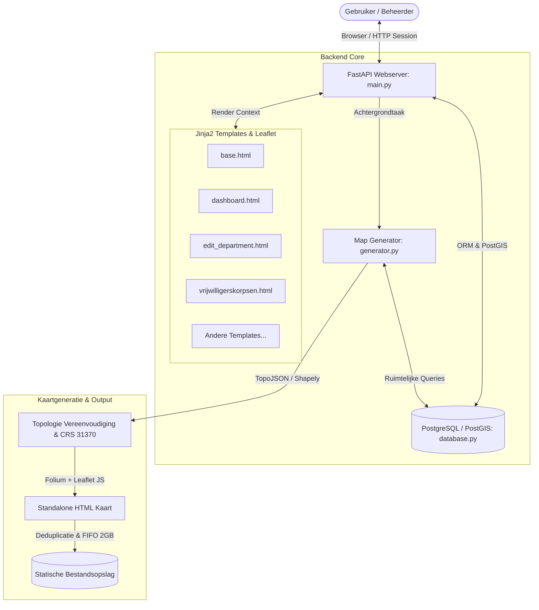
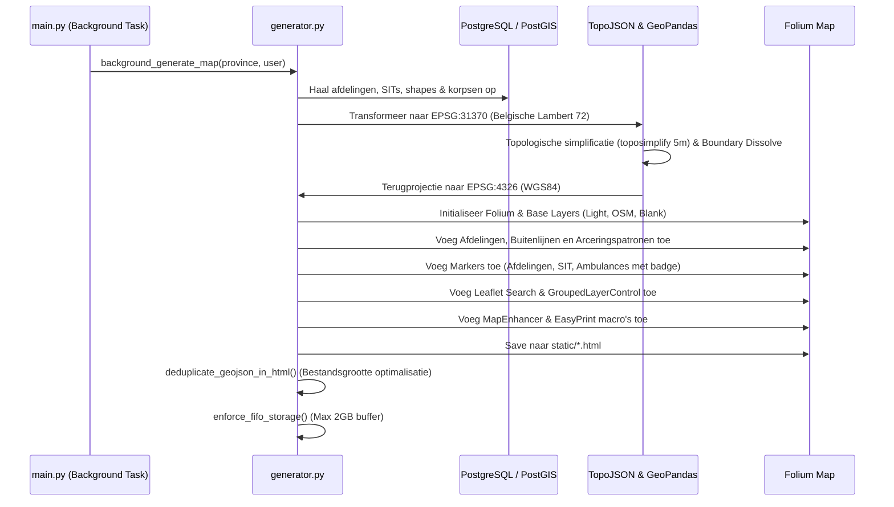

# Rode Kruis Map Generator (V2)

Een gespecialiseerde webapplicatie ontworpen om de geografische indeling, afdelingen, werkingsgebieden (clusters), regio's, disciplines, logistieke SIT-locaties en vrijwilligerskorpsen van Rode Kruis-Vlaanderen interactief te beheren en te exporteren naar standalone, interactieve HTML-kaarten.

---

## Inhoudsopgave
1. [Systeemarchitectuur & Technologieën](#1-systeemarchitectuur--technologieën)
2. [Data-Architectuur: `database.py`](#2-data-architectuur-databasepy)
3. [Applicatie-Logica & GUI Controller: `main.py`](#3-applicatie-logica--gui-controller-mainpy)
4. [Interactieve Kaartgenerator: `generator.py`](#4-interactieve-kaartgenerator-generatorpy)
5. [Overzicht van de HTML Templates](#5-overzicht-van-de-html-templates)
6. [Speciale & Geavanceerde Features](#6-speciale--geavanceerde-features)

---

## 1. Systeemarchitectuur & Technologieën

Het platform verbindt een relationele PostgreSQL/PostGIS databank met een FastAPI webapplicatie, Jinja2 frontend templates met Leaflet.js, en een geavanceerde ruimtelijke generatormodule gebaseerd op Folium en GeoPandas.



### Belangrijkste Componenten
- **Webframework**: [FastAPI](https://fastapi.tiangolo.com/) met asynchrone endpoints en Jinja2 templating.
- **Database & Ruimtelijke Laag**: PostgreSQL + PostGIS via [SQLAlchemy](https://www.sqlalchemy.org/) en [GeoAlchemy2](https://geoalchemy-2.readthedocs.io/).
- **GIS Verwerking**: [GeoPandas](https://geopandas.org/), [Shapely](https://shapely.readthedocs.io/), [TopoJSON](https://github.com/mattijn/topojson), en [Folium](https://python-visualization.github.io/folium/).
- **Frontend & Kaarten**: Vanilla JS, [Leaflet.js](https://leafletjs.com/), FontAwesome 6, en aangepaste CSS componenten.
- **Geocoding**: [Nominatim / Geopy](https://geopy.readthedocs.io/) met persistente SQL caching.

---

## 2. Data-Architectuur: `database.py`

Het datamodel is ontworpen om zowel klassieke administratieve gegevens als GIS-polygonen en audit trails te ondersteunen:

### Overzicht van de Datamodellen

| Model | Tabelnaam | Doel & Beschrijving |
| :--- | :--- | :--- |
| `User` | `users` | Gebruikersaccounts met rollen (`admin`, `nationaal`, `provinciaal`), provinciale beperking (`province_access`) en een hard-lock vlag (`force_password_change`). |
| `Department` | `departments` | Rode Kruis afdelingen en provinciale zetels (`type="afdeling"` of `"provinciale_zetel"`). Bevat contactgegevens, postadres, hex-kleurcode, entiteitnummer, website overrides en coördinaten. |
| `DepartmentShape` | `department_shapes` | PostGIS tabel (`MULTIPOLYGON`, SRID 4326) met grenzen van (deel)gemeenten, gekoppeld aan een afdeling via `department_id` en `MatchMethodEnum`. |
| `Region` | `regions` | Bovenliggende groepering van afdelingen binnen een provincie (bijv. Regio Noord, Regio Zuid). |
| `Cluster` | `clusters` | Werkingsgebieden die meerdere afdelingen verenigen onder een regio. |
| `Service` | `services` | Beschikbare disciplines/diensten (bijv. Jeugd, Zorgbib, Brugfiguren, Uitleendienst, Internationale Samenwerking). Gekoppeld via de tussentabel `department_services`. |
| `Vehicle` | `vehicles` | Hulpverleningsvoertuigen (bijv. ambulances) gekoppeld aan een afdeling, met roepnaam, vlootnummer en optioneel afwijkende standplaats/coördinaten. |
| `SitLocation` | `sit_locations` | Snelle Interventieteams (SIT) uitvalsbases met types zoals SIT-MED, SIT-LOG of combinaties. |
| `SitVehicle` | `sit_vehicles` | Voertuigen gestationeerd op specifieke SIT-locaties. |
| `VolunteerCorps` | `volunteer_corps` | Registratie van vrijwilligerskorpsen per Vlaamse hoofdgemeente, inclusief 8 afzonderlijke voortgangsfasen (`phase_1` t/m `phase_8`). |
| `CoordinateCache` | `coordinate_cache` | Lokale cache voor geocodering om herhaaldelijke externe Nominatim API-aanroepen te voorkomen. |
| `AuditLog` | `audit_logs` | Onveranderbare historiek van alle acties (CREATE, UPDATE, DELETE) inclusief tijdstip, gebruiker en gewijzigde details. |

---

## 3. Applicatie-Logica & GUI Controller: `main.py`

`main.py` fungeert als het centrale zenuwstelsel van de webapplicatie. Het beheert de routering, sessies, autorisatie, API-endpoints en de achtergrondtaken voor het genereren van kaarten.

### Belangrijkste Taken & Functionaliteiten

#### 1. Beveiliging & Autorisatie (RBAC)
- **Sessiebeheer**: Beveiligd via Starlette `SessionMiddleware` met een automatische time-out van 4 uur.
- **Rollenmatrix**:
  - `admin`: Volledige rechten op alle provincies en gebruikersbeheer.
  - `nationaal`: Volledige rechten om data in alle provincies te bewerken en kaarten voor heel Vlaanderen te genereren.
  - `provinciaal`: Kan uitsluitend data bewerken binnen de eigen provincie (`province_access`). Andere provincies worden in de GUI getoond in een **read-only** modus (velden vergrendeld, opslaan geblokkeerd).
- **Hard-Lock Password Change**: Als `user.force_password_change == True`, vangt `ForcePasswordChangeException` elk verzoek af en dwingt de gebruiker direct naar het wachtwoordwijzigingsscherm.

#### 2. Adresresolutie & Caching (`resolve_address`)
- Voert geocoding uit via OpenStreetMap/Nominatim.
- Voegt automatisch `, België` toe voor nauwkeurigheid.
- Hanteert een verplichte slaaptijd van 1.1s voor rate limiting en slaat gevonden breedte- en lengtegraden direct op in de tabel `coordinate_cache`.

#### 3. Interactieve Polygonen-API voor Afdelingen
- `GET /api/departments/{dept_id}/shapes`: Haalt alle deelgemeentevlakken op voor de provincie van de afdeling. Elke polygoon krijgt een status mee:
  - `current` (rood): Toegewezen aan de huidige geopende afdeling.
  - `other` (blauw): Reeds toegewezen aan een andere afdeling.
  - `empty` (grijs): Vrij / niet toegewezen.
- `POST /api/departments/{dept_id}/shapes/{shape_id}/toggle`: Maakt het mogelijk om in real-time deelgemeenten toe te voegen of los te koppelen van de afdeling met één muisklik op de Leaflet-kaart in het bewerkingsscherm.

#### 4. Marker Clustering & Pin API
- `GET /api/departments/{dept_id}/markers`: Verzamelt de hoofdlocatie en alle voertuigen van een afdeling en levert deze in JSON-formaat. In de frontend worden markers met dezelfde coördinaten samengevoegd tot één pin met een cijferbadge.

#### 5. Fusietool voor Afdelingen (`/departments/merge`)
- Maakt het mogelijk om twee afdelingen te selecteren en hun werkingsgebieden, leden (deelgemeenten), voertuigen en disciplines automatisch samen te voegen in een nieuw conceptmodel via `SimpleNamespace`. De gebruiker kan het concept direct nakijken en opslaan.

#### 6. Achtergrondgeneratie & Taakbeheer (`generator_wrapper`)
- Kaarten genereren kost rekenkracht en GIS-verwerkingstijd. `main.py` start de generatie in een FastAPI `BackgroundTask`.
- **Limiet**: Er mogen maximaal 2 generaties gelijktijdig draaien (`ACTIVE_GENERATIONS`).
- **Live Status Polling**: `GET /api/generation-status` levert de status van lopende taken (`running`, `completed`, `failed`), waarmee het dashboard realtime geanimeerde toast-meldingen toont.

#### 7. Vrijwilligerskorpsen Module (Excel Diff & GIS)
- `POST /api/vrijwilligerskorpsen/upload`: Leest het wekelijkse Excel-rapport (*sheet: 'Geïnteresseerde gemeenten'*) in geheugen via Pandas en berekent een **Diff** tussen de Excel en de database (nieuwe gemeenten vs. statusupdates).
- `POST /api/vrijwilligerskorpsen/sync`: Past na goedkeuring van de beheerder de Excel-diff in bulk toe op de database.
- `GET /api/vrijwilligerskorpsen/map_data`: Haalt geünificeerde PostGIS-polygonen op van alle Vlaamse gemeenten (waarbij Brussel en Wallonië via postcodefilters strikt worden uitgesloten) met hun actieve korpsfase.

---

## 4. Interactieve Kaartgenerator: `generator.py`

`generator.py` bouwt de uiteindelijke HTML-kaart op basis van de databank. De geproduceerde kaarten zijn volledig interactief, zelfstandig bruikbaar en bevatten embedded GIS-vectordata en JavaScript controles.

### Architectuur van de Kaartgenerator



### Belangrijkste Functionaliteiten in `generator.py`

#### 1. Publieke vs. Interne Kaartmodus
- **Publieke Kaart (`public_version=True`)**:
  - Bevat enkel basisafdelingsgrenzen en officiële contactgegevens.
  - Verbergt interne disciplines, SIT-bases, ziekenwagens en vrijwilligerskorpsen.
  - Toont in pop-ups een opvallende **"Word vrijwilliger"** actieknop die rechtstreeks doorlinkt naar de rekruteringspagina van de afdeling.
- **Interne Kaart (`public_version=False`)**:
  - Toont alle operationele disciplines als diagonale streepjespatronen.
  - Toont SIT-steunpunten en ziekenwagenstandplaatsen.
  - Bevat entiteitnummers in de pop-ups en in de zoekbalk.
  - Toont vrijwilligerskorpsen (Fase 4+ samenwerkingsovereenkomst) in het groen.

#### 2. Ruimtelijke Wiskunde & Optimalisaties
- **CRS Transformatie (EPSG:31370 <-> EPSG:4326)**: Geometrische berekeningen (zoals buffers, raakvlakken en simplificaties) gebeuren in het metrische Belgische Lambert 72-stelsel (`EPSG:31370`) voor maximale precisie.
- **Topologische Vereenvoudiging**: Gebruikt `topojson.Topology` met `toposimplify(5)` om aangrenzende grenzen samen te vereenvoudigen zonder dat er kieren (gaps) of overlap tussen afdelingen ontstaan.
- **Afronding & Validering**: Coördinaten worden afgerond op 5 decimalen met Shapely `loads(dumps(..., rounding_precision=5))`. Dit reduceert de bestandsgrootte met 40% zonder merkbaar kwaliteitsverlies.
- **Enclave/Overlap Detectie**: Detecteert automatisch of een gebied volledig ingesloten ligt in een ander gebied en past transparantie toe zodat onderliggende lagen klikbaar blijven.
- **Gemeenschappelijke Regiogrenzen**: Berekent via ruimtelijke doorsneden (`itertools.combinations` + `geom1.intersection(geom2)`) de gedeelde buitengrenzen van regio's.

#### 3. Visuele Lagen & Iconografie
- **Lagenstructuur**:
  - *Afdelingen*: Deelgemeenten (gestippelde lijn `dashArray: '5,5'`), hoofdgemeenten (volle lijn, dikte 2.0), en afdelingsbuitengrenzen (extra dikke lijn, dikte 2.8).
  - *Kleurloze Afdelingen*: Transparante polygonen met JavaScript klikinteractie (rood oplichten bij aanklikken).
  - *Disciplines (StripePattern)*:
    - **Jeugd**: Oranje arceerpatroon (45°).
    - **Zorgbib**: Paars arceerpatroon (-45°).
    - **Brugfiguren**: Teal arceerpatroon (90°).
    - **Internationale Samenwerking**: Blauw arceerpatroon (0°).
    - **Uitleendienst**: Groen arceerpatroon (135°).
  - *Voertuigen*: Ambulancemarkers met een dynamische badge die het aantal wagens toont indien meerdere voertuigen op hetzelfde adres staan.
  - *SIT Locaties*: Pins met kleurverloop (rood voor medisch, blauw voor logistiek, paars/gesplitst voor gecombineerd).

#### 4. Aangepaste Leaflet JavaScript Uitbreidingen
- `MapEnhancer`:
  - Dwingt een strikte Z-index af (`enforceZOrder`) zodat labels en markers altijd bovenop de vlakken liggen.
  - Converteert Folium layer-controls dynamisch: de basiskaart en afdelingsweergaven worden **radioknoppen** (slechts 1 tegelijk actief), terwijl disciplines en overlays **selectievakjes (checkboxes)** blijven.
  - Lost touch-scroll problemen op mobiele apparaten op.
- `EasyPrint`: Biedt een ingebouwde print- en exportknop (A4 Landschap of Huidige Weergave).
- **Slimme Zoekfunctie**: Folium `Search` plugin die tegelijk zoekt op deelgemeente, hoofdgemeente, afdelingsnaam (inclusief entiteitnummer) en postcode. Gevonden resultaten worden automatisch na 30 seconden gewist om de kaart schoon te houden.

#### 5. Post-Processing & FIFO Opslag
- `deduplicate_geojson_in_html()`: Regex-parser die herhaalde GeoJSON-geometrieën in de geëxporteerde HTML opspoort en vervangt door gedeelde JavaScript variabelen (`shared_geojson_data_x`). Dit halveert de bestandsgrootte van complexe kaarten.
- `enforce_fifo_storage()`: Bewaakt de opslagmap (`/opt/MapGenerator/static`). Zodra de totale omvang de 2 GB overschrijdt, worden de oudste HTML-kaarten automatisch verwijderd.

---

## 5. Overzicht van de HTML Templates

Alle webpagina's erven over van `base.html` en maken gebruik van responsive design en FontAwesome iconen.

```
templates/
├── base.html                 # Hoofdlayout met navigatiebalk, gebruikersmenu en CSS variabelen
├── dashboard.html            # Generator formulier, tabel met gegenereerde kaarten en live toasts
├── departments.html          # Overzicht van alle afdelingen met zoekfilter
├── edit_department.html      # Uitgebreid afdelingsformulier met interactieve Leaflet polygoon-editor
├── provinciale_zetels.html   # Lijst met provinciale zetels
├── merge_departments.html    # Wizard om 2 afdelingen samen te voegen (fusie)
├── sit_locations.html        # Overzicht van SIT uitvalsbases
├── edit_sit.html             # Bewerken van SIT locaties en gekoppelde voertuigen
├── regions.html              # Beheer van regio's en toewijzing van afdelingen
├── clusters.html             # Beheer van werkingsgebieden (clusters) binnen regio's
├── vrijwilligerskorpsen.html # Excel upload, Diff-viewer, fasebeheer en Vlaanderen-overzichtskaart
├── maps.html                 # Kaartenoverzicht
├── preview_map.html          # Volledig scherm weergave van een gegenereerde HTML kaart
├── audit_logs.html           # Read-only audit logboek van de laatste 200 bewerkingen
├── users.html                # Gebruikersbeheer (enkel zichtbaar voor Admin)
├── edit_user.html            # Gebruiker aanmaken/bewerken, rechten en wachtwoordreset
├── login.html                # Inlogscherm
├── change_password.html      # Wachtwoord wijzigen door ingelogde gebruiker
└── force_password.html       # Geforceerd wachtwoord reset scherm (Hard-Lock)
```

### Belangrijkste Templates in Detail

#### 1. `templates/base.html`
- Bevat de uniforme header, het logo, navigatie-items met actieve toestandmarkering en het profielmenu (gebruikersnaam, wachtwoord wijzigen, uitloggen).
- Toont de navigatielink naar *Gebruikersbeheer* uitsluitend als de aangemelde gebruiker de rol `admin` heeft.

#### 2. `templates/dashboard.html`
- **Startpunt van de applicatie**:
  - Dropdown om een provincie (of heel Vlaanderen) te selecteren.
  - Schakelaar voor de **Publieke versie** (verbergt interne disciplines/SIT).
  - Lijst met reeds gegenereerde HTML-kaarten inclusief aanmaakdatum, bestandsgrootte en knoppen voor *Bekijk* en *Download*.
  - **Asynchrone Toast Notificaties**: JavaScript pollt `/api/generation-status` elke 2 seconden. Bij actieve generaties verschijnt een zwevende kaart met geanimeerde laadbalk. Zodra de taak klaar is, kleurt de toast groen en herlaadt de pagina automatisch.

#### 3. `templates/edit_department.html`
- **Het meest geavanceerde formulier van het platform**:
  - *Basisgegevens*: Naam, provincie, regio, entiteitnummer, adres, postadres, e-mail, telefoon en kleurkiezer.
  - *Disciplines*: Selectievakjes voor Jeugd, Zorgbib, Brugfiguren, Uitleendienst en Internationale Samenwerking.
  - *Voertuigen*: Dynamische lijst waar met één druk op de knop voertuigen kunnen worden toegevoegd of verwijderd (inclusief roepnaam, vlootnummer en afwijkend adres).
  - *Geïntegreerde Leaflet Editor*: Toont de grenzen van alle omliggende deelgemeenten. De beheerder kan eenvoudig op een polygoon klikken om deze toe te wijzen aan de afdeling of weer vrij te geven. Wijzigingen worden via `fetch` direct naar de API gestuurd zonder dat de pagina hoeft te herladen.
  - *Marker Clustering*: Toont pins voor de hoofdzetel en voertuigen, waarbij overlappende voertuigen op hetzelfde adres automatisch worden gebundeld in een paarse marker met een cijferbadge.

#### 4. `templates/vrijwilligerskorpsen.html`
- Biedt drie opeenvolgende panelen:
  1. **Excel Upload & Diff Viewer**: Upload van het wekelijkse Excel-rapport. Wijzigingen ten opzichte van de database worden in een diff-tabel getoond (Nieuw / Update) voordat de gebruiker ze definitief accepteert.
  2. **Manuele Opvolging**: Tabel van alle Vlaamse gemeenten met een dropdown voor de huidige fase (Fase 1 t/m Fase 8). Hogere fasen vinken automatisch alle voorgaande fasen af.
  3. **Geografisch Overzicht (Leaflet)**: Realtime overzichtskaart van Vlaanderen waarbij gemeenten worden ingekleurd op basis van hun voortgangsfase.

#### 5. `templates/merge_departments.html`
- Wizard voor het samenvoegen van twee afdelingen. Na selectie van Afdeling A en B worden alle voertuigen, gemeenten en contacten samengevoegd en geopend in `edit_department.html` als een conceptafdeling.

#### 6. `templates/audit_logs.html`
- Toont een overzichtelijke tabel van de 200 meest recente acties in het systeem, met kleurcodering voor `CREATE` (groen), `UPDATE` (blauw) en `DELETE` (rood).

---

## 6. Speciale & Geavanceerde Features

1. **Topologische Vereenvoudiging zonder Kieren**:
   In tegenstelling tot standaard vereenvoudigingen (zoals Douglas-Peucker op individuele polygonen) gebruikt de generator `topojson.Topology`. Hierdoor blijven gedeelde grenzen tussen afdelingen exact op elkaar aansluiten, zonder dat er witte gaten of overlappende stroken ontstaan.

2. **Ruimtelijke Enclave- en Overlap-Detectie**:
   Het algoritme berekent automatisch of een afdeling geografisch binnen een andere ligt (`contains`). Binnenliggende vlakken krijgen dynamisch transparantie en aangepaste stijlen zodat beide gebieden zichtbaar en interactief blijven.

3. **Geocodering met Persistente Database Caching**:
   Adresconversie naar coördinaten kan traag zijn en heeft vaak te maken met strikte rate limits. Door `CoordinateCache` in PostgreSQL worden adressen eenmalig opgezocht en vervolgens lokaal hergebruikt, waardoor latere kaartgeneraties seconden sneller verlopen.

4. **Interactief Grenzen Toewijzen via de Web-UI**:
   In `edit_department.html` hoeft een beheerder geen GIS-software (zoals QGIS) te openen. Men klikt simpelweg op deelgemeenten op de interactieve Leaflet-kaart om grenzen direct in de database toe te wijzen of te ontkoppelen.

5. **Multi-Item Marker Clustering met Badges**:
   Wanneer een afdeling meerdere ziekenwagens op hetzelfde adres heeft staan als het afdelingsgebouw, tekent de kaart geen overlappende, onleesbare markers, maar bundelt deze tot één duidelijke marker met een numerieke badge (bijv. "3") en een gegroepeerde pop-up.

6. **GeoJSON Deduplicatie in HTML Output**:
   Door herhaalde geometrieën via regex te vervangen door gedeelde JavaScript variabelen, blijft het uiteindelijke geëxporteerde HTML-bestand compact en snel in de browser, zelfs bij honderden complexe polygonen.

7. **Strikte Provinciale Scoping (RBAC) & Read-Only GUI**:
   Provinciale gebruikers kunnen door heel Vlaanderen navigeren om afdelingen te inspecteren, maar de GUI schakelt automatisch over naar read-only wanneer zij een afdeling buiten hun eigen provincie openen.

8. **FIFO Schijfbeheer (2 GB Limiet)**:
   Gegenereerde interactieve kaarten kunnen tientallen megabytes groot zijn. Het FIFO-mechanisme voorkomt dat de server volluipt door automatisch de oudste kaarten te wissen wanneer de schijfruimte overschreden wordt.
