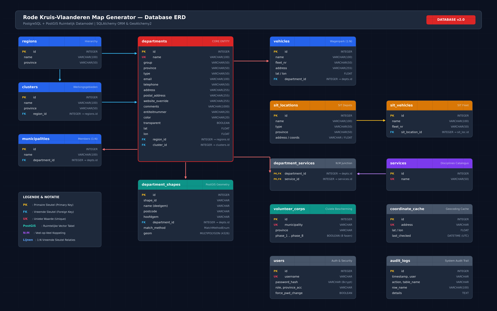
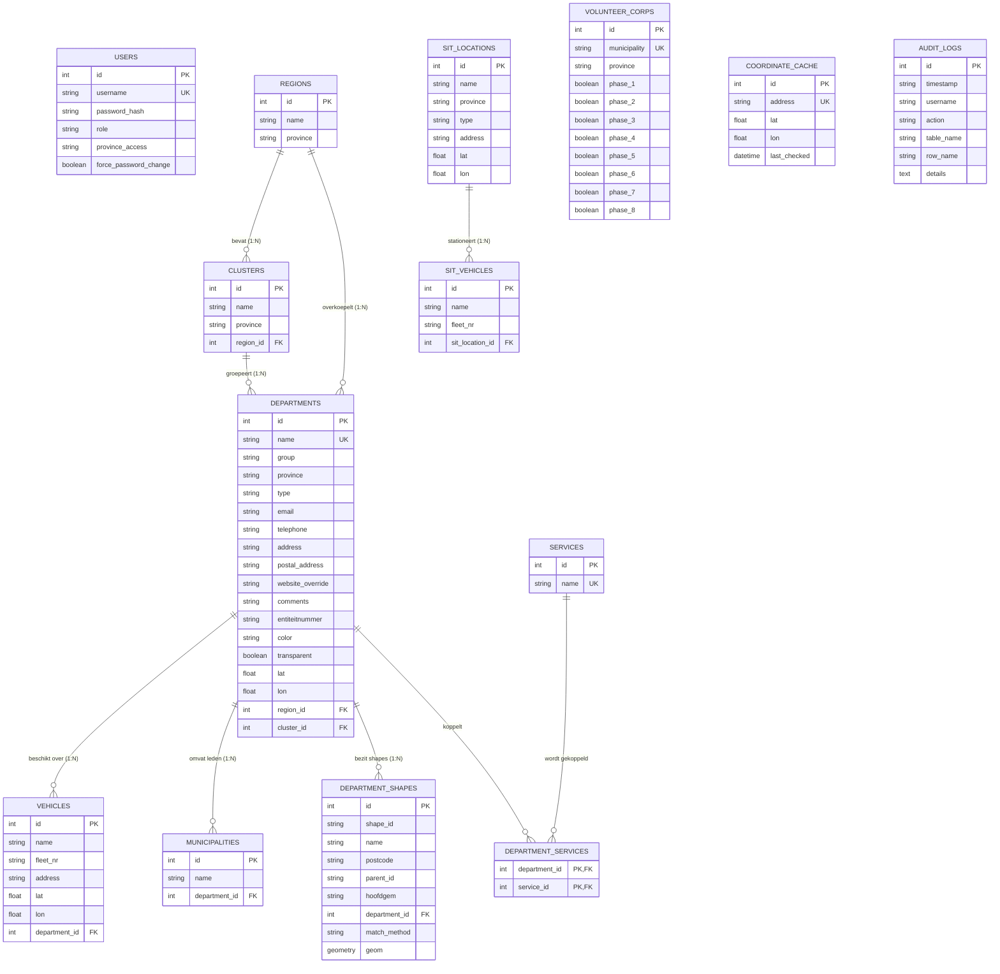

# Database Documentatie & ERD - Rode Kruis Map Generator

Dit document beschrijft de volledige databankarchitectuur van de **Rode Kruis Map Generator (V2)**, inclusief een grafisch Entity-Relationship Diagram (ERD), tabeldefinities, relaties, en toelichting op de PostGIS-ruimtelijke integratie.

De databank draait op **PostgreSQL** uitgebreid met de **PostGIS** extensie (via `GeoAlchemy2`) voor het opslaan en bevragen van geografische vectordata (polygonen en multipolygonen).

---

## 1. Entity-Relationship Diagram (ERD)

Het onderstaande schema toont alle tabellen, primaire sleutels (`PK`), vreemde sleutels (`FK`), unieke constraints (`UK`) en de onderlinge relaties binnen de databank:

<b>Klik hier voor de tekstuele Mermaid-specificatie</b>

---

## 2. Tabeldefinities en Data Dictionary

### 2.1 Kernentiteiten: Afdelingen en Structuur

#### Tabel: `departments`
De centrale tabel van het systeem. Bevat zowel lokale Rode Kruis-afdelingen als provinciale zetels en 112-standplaatsen.
- `id` (`INTEGER`, PK): Unieke numerieke identifier.
- `name` (`VARCHAR(100)`, UK, NOT NULL, INDEX): Officiële naam van de afdeling (bijv. `"Mechelen"`, `"Gent"`).
- `group` (`VARCHAR(50)`, Nullable): Vrij tekstveld voor legacy regio-aanduiding.
- `province` (`VARCHAR(50)`, NOT NULL, INDEX): Provincie waarin de afdeling actief is.
- `type` (`VARCHAR(50)`, Default `"afdeling"`): Type entiteit (`"afdeling"`, `"provinciale_zetel"`, of `"112_standplaats"`).
- `email` (`VARCHAR(100)`, Nullable): Contact e-mailadres van de afdeling.
- `telephone` (`VARCHAR(50)`, Nullable): Contact telefoonnummer.
- `address` (`VARCHAR(255)`, Nullable): Fysiek gebouw- of vestigingsadres.
- `postal_address` (`VARCHAR(255)`, Nullable): Optioneel afwijkend postadres (bijv. postbus).
- `website_override` (`VARCHAR(255)`, Nullable): Afwijkende website URL (indien leeg, geldt de standaard Rode Kruis conventie).
- `comments` (`VARCHAR(1000)`, Nullable): Interne notities voor beheerders.
- `entiteitnummer` (`VARCHAR(20)`, Nullable): Officieel administratief entiteitnummer van Rode Kruis-Vlaanderen.
- `color` (`VARCHAR(20)`, Nullable): Hexadecimale kleurcode voor polygonen op de kaart (bijv. `"#d32f2f"`).
- `transparent` (`BOOLEAN`, Default `False`): Schakelaar om de polygoon transparant te renderen.
- `lat` / `lon` (`FLOAT`, Nullable): Expliciete geografische WGS84 coördinaten van het gebouw.
- `region_id` (`INTEGER`, FK -> `regions.id`, Nullable): Relatie naar de bovenliggende regio.
- `cluster_id` (`INTEGER`, FK -> `clusters.id`, Nullable): Relatie naar het bovenliggende werkingscluster.

#### Tabel: `regions`
Bovenliggende provinciale regio's (bijv. Regio Noord, Regio Mechelen-Rivierenland).
- `id` (`INTEGER`, PK): Unieke identifier.
- `name` (`VARCHAR(100)`, NOT NULL): Naam van de regio.
- `province` (`VARCHAR(50)`, NOT NULL): Provincie van de regio.

#### Tabel: `clusters`
Werkingsgebieden die meerdere afdelingen verenigen onder een regio.
- `id` (`INTEGER`, PK): Unieke identifier.
- `name` (`VARCHAR(100)`, NOT NULL): Naam van het werkingsgebied/cluster.
- `province` (`VARCHAR(50)`, NOT NULL): Provincie.
- `region_id` (`INTEGER`, FK -> `regions.id`, Nullable): Vreemde sleutel naar de overkoepelende regio.

#### Tabel: `municipalities`
Lijst van gemeenten die officieel lid zijn van een afdeling.
- `id` (`INTEGER`, PK): Unieke identifier.
- `name` (`VARCHAR(100)`, NOT NULL): Gemeentenaam.
- `department_id` (`INTEGER`, FK -> `departments.id`): Gekoppelde afdeling (met `cascade="all, delete-orphan"`).

---

### 2.2 PostGIS Ruimtelijke Laag

#### Tabel: `department_shapes`
Bevat de cartografische grenzen van Belgische deelgemeenten en hoofdgemeenten.
- `id` (`INTEGER`, PK): Unieke identifier.
- `shape_id` (`VARCHAR`, INDEX): Unieke GIS-identifier van de polygoon.
- `name` (`VARCHAR`, INDEX): Naam van de deelgemeente.
- `postcode` (`VARCHAR`, Nullable): Postcode van de deelgemeente.
- `parent_id` (`VARCHAR`, Nullable): Referentie naar de bovenliggende administratieve eenheid.
- `hoofdgem` (`VARCHAR`, Nullable): Naam van de fuserende hoofdgemeente.
- `department_id` (`INTEGER`, FK -> `departments.id`, Nullable): Vreemde sleutel die bepaalt welke afdeling eigenaar is van dit geografische gebied.
- `match_method` (`ENUM`, Nullable): Wijze waarop het vlak is gekoppeld (`MatchMethodEnum`).
- `geom` (`GEOMETRY(MULTIPOLYGON, 4326)`): De werkelijke geometrie opgeslagen in WGS84 coördinatenstelsel (SRID 4326).

##### Enum: `MatchMethodEnum`
- `Naam_Match`: Automatisch gekoppeld op basis van overeenkomstige afdelings- en gemeentenaam.
- `Hoofdgemeente_Match`: Gekoppeld via de hoofdgemeente.
- `Ruimtelijke_Afstand_Dichtstbijzijnd`: Berekend op basis van de kleinste geometrische afstand.
- `Manuele_Override`: Handmatig door een beheerder toegekend via de interactieve Leaflet editor in de webinterface.

---

### 2.3 Disciplines / Diensten

#### Tabel: `services`
Catalogus van operationele diensten en disciplines binnen Rode Kruis-Vlaanderen.
- `id` (`INTEGER`, PK): Unieke identifier.
- `name` (`VARCHAR(50)`, UK, NOT NULL): Naam van de discipline (bijv. `"Jeugd"`, `"Zorgbib"`, `"Brugfiguren"`, `"Uitleendienst"`, `"Internationale Samenwerking"`).

#### Tussentabel: `department_services`
Veel-op-veel (N:M) koppeling tussen afdelingen en aangeboden disciplines.
- `department_id` (`INTEGER`, PK, FK -> `departments.id`): ID van de afdeling.
- `service_id` (`INTEGER`, PK, FK -> `services.id`): ID van de discipline.

---

### 2.4 Voertuigen en Logistiek

#### Tabel: `vehicles`
Voertuigen (voornamelijk ziekenwagens) gekoppeld aan lokale afdelingen.
- `id` (`INTEGER`, PK): Unieke identifier.
- `name` (`VARCHAR(100)`, NOT NULL): Roepnaam van het voertuig (bijv. `"AMBU 1"`).
- `fleet_nr` (`VARCHAR(50)`, Nullable): Intern vlootnummer (bijv. `"VL-4021"`).
- `address` (`VARCHAR(255)`, Nullable): Optioneel afwijkende standplaats (indien leeg, geldt het adres van de afdeling).
- `lat` / `lon` (`FLOAT`, Nullable): Expliciete coördinaten van de standplaats.
- `department_id` (`INTEGER`, FK -> `departments.id`): Eigenaar-afdeling (met cascade verwijdering).

#### Tabel: `sit_locations`
Snelle Interventieteams (SIT) logistieke en medische uitvalsbases.
- `id` (`INTEGER`, PK): Unieke identifier.
- `name` (`VARCHAR(100)`, NOT NULL): Naam van de SIT-basis.
- `province` (`VARCHAR(50)`, Nullable): Provincie.
- `type` (`VARCHAR(50)`, Nullable): Type basis (bijv. `"SIT-MED"`, `"SIT-LOG"`, of combi).
- `address` (`VARCHAR(255)`, Nullable): Adres van het depot.
- `lat` / `lon` (`FLOAT`, Nullable): Geografische coördinaten.

#### Tabel: `sit_vehicles`
Voertuigen en aanhangwagens die exclusief gestationeerd zijn op een SIT-locatie.
- `id` (`INTEGER`, PK): Unieke identifier.
- `name` (`VARCHAR(100)`, NOT NULL): Roepnaam/type van het SIT-voertuig.
- `fleet_nr` (`VARCHAR(50)`, Nullable): Vlootnummer.
- `sit_location_id` (`INTEGER`, FK -> `sit_locations.id`): Gekoppelde SIT-basis (met cascade verwijdering).

---

### 2.5 Vrijwilligerskorpsen (Civiele Bescherming / Noodplanning)

#### Tabel: `volunteer_corps`
Opvolging van de oprichting van vrijwilligerskorpsen per Vlaamse gemeente over 8 vaste fasen.
- `id` (`INTEGER`, PK): Unieke identifier.
- `municipality` (`VARCHAR`, UK, NOT NULL, INDEX): Naam van de hoofdgemeente.
- `province` (`VARCHAR`, Nullable): Provincie.
- `phase_1` t/m `phase_8` (`BOOLEAN`, Default `False`):
  - `phase_1`: Gemeente geregistreerd via landingspagina.
  - `phase_2`: Lokale RKV afdeling geïnformeerd.
  - `phase_3`: Gemeente gecontacteerd door RKV.
  - `phase_4`: Samenwerkingsovereenkomst ondertekend.
  - `phase_5`: Communicatie plaatsgevonden.
  - `phase_6`: Minstens 20 vrijwilligers geregistreerd.
  - `phase_7`: Basisopleiding ingepland.
  - `phase_8`: Korps operationeel activeerbaar.

---

### 2.6 Beveiliging, Caching & Auditing

#### Tabel: `users`
Gebruikersbeheer met rolgebaseerde toegangscontrole (RBAC).
- `id` (`INTEGER`, PK): Unieke identifier.
- `username` (`VARCHAR`, UK, NOT NULL, INDEX): Unieke gebruikersnaam.
- `password_hash` (`VARCHAR`, NOT NULL): Gehasht wachtwoord via Bcrypt.
- `role` (`VARCHAR`, NOT NULL): Rol (`"admin"`, `"nationaal"`, of `"provinciaal"`).
- `province_access` (`VARCHAR`, Nullable): Toegewezen provincie indien `role == "provinciaal"`.
- `force_password_change` (`BOOLEAN`, Default `False`): Hard-lock vlag die de gebruiker dwingt eerst een nieuw wachtwoord in te stellen.

#### Tabel: `coordinate_cache`
Voorkomt herhaaldelijke externe geocoding-aanroepen naar Nominatim/OpenStreetMap.
- `id` (`INTEGER`, PK): Unieke identifier.
- `address` (`VARCHAR`, UK, NOT NULL, INDEX): Het uniek genormaliseerde adres (inclusief `", België"`).
- `lat` / `lon` (`FLOAT`, NOT NULL): Gecachete WGS84 breedte- en lengtegraad.
- `last_checked` (`DATETIME`, UTC): Tijdstip van geocodering.

#### Tabel: `audit_logs`
Volledig audittrail van alle wijzigingen in de applicatie.
- `id` (`INTEGER`, PK): Unieke identifier.
- `timestamp` (`VARCHAR(50)`): Datum en tijdstip van de actie (`DD/MM/YYYY HH:MM:SS`).
- `username` (`VARCHAR(50)`, NOT NULL): Gebruiker die de actie uitvoerde.
- `action` (`VARCHAR(20)`, NOT NULL): Actietype (`"CREATE"`, `"UPDATE"`, of `"DELETE"`).
- `table_name` (`VARCHAR(50)`, NOT NULL): Gewijzigde tabel (bijv. `"Afdeling"`, `"SIT"`, `"Vrijwilligerskorpsen"`).
- `row_name` (`VARCHAR(100)`, NOT NULL): Naam van de gewijzigde entiteit.
- `details` (`TEXT`, Nullable): Omschrijving van de gewijzigde attributen of context.

---

## 3. Integriteit, Cascades en Foreign Key Gedrag

1. **Afdelingsverwijdering (`Department` -> `Cascade`)**:
   - Wanneer een afdeling wordt verwijderd, worden de gekoppelde `vehicles` en `municipalities` automatisch mee verwijderd (`cascade="all, delete-orphan"`).
   - De records in `department_shapes` worden **niet** verwijderd, maar hun `department_id` wordt op `NULL` gezet via de relationele logica, zodat de geografische polygoon beschikbaar blijft voor toewijzing aan een andere afdeling.
   - De N:M koppelingen in `department_services` worden automatisch opgeruimd.

2. **Regio- en Clusterhiërarchie (`Region` -> `Cluster` -> `Department`)**:
   - Een `Region` bevat meerdere `Clusters`. Als een regio wordt verwijderd, worden de onderliggende clusters mee verwijderd (`cascade="all, delete-orphan"`).
   - De afdelingen zelf blijven bewaard, waarbij hun `region_id` en `cluster_id` worden losgekoppeld.

3. **SIT-locaties (`SitLocation` -> `SitVehicle`)**:
   - Verwijdering van een SIT-locatie verwijdert automatisch alle daaraan verbonden SIT-voertuigen (`cascade="all, delete-orphan"`).
